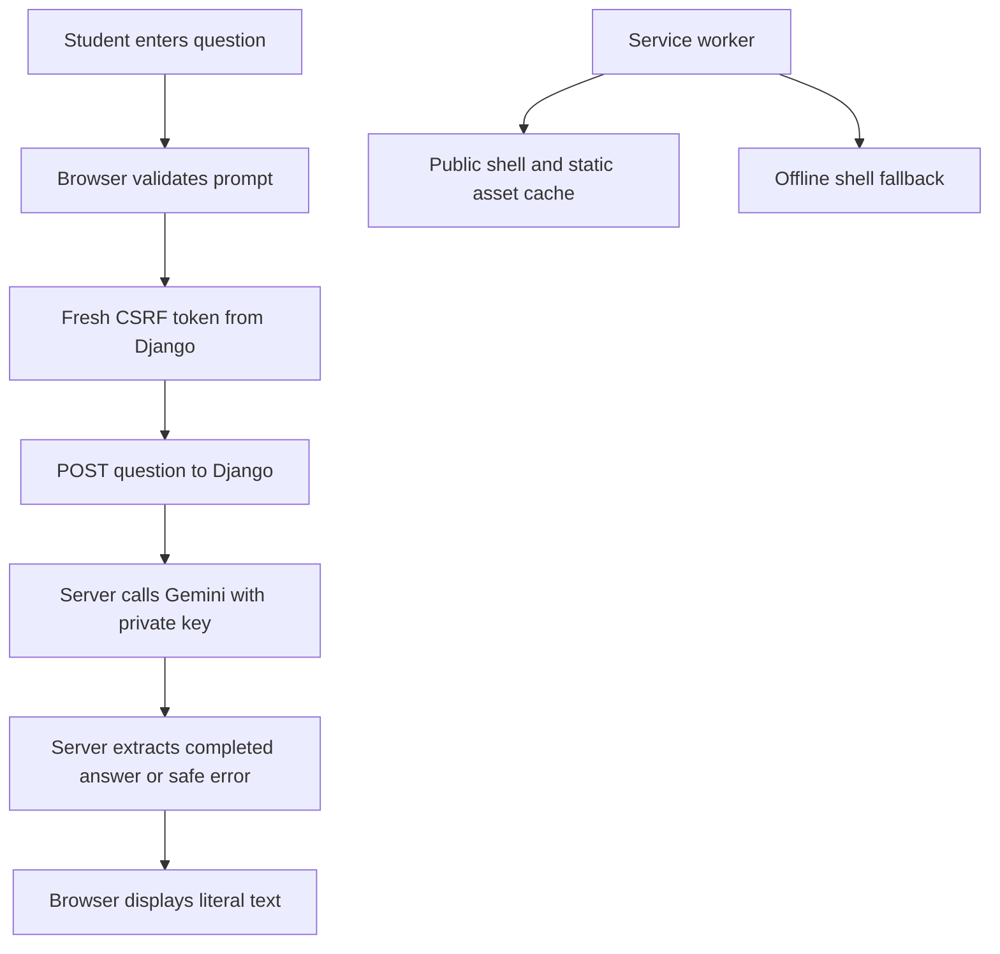

# Individual AI Assistant - Plan

## Goal Capsule

- Objective: The student can demonstrate an installable web assistant that accepts a question, returns a real Gemini answer, and explains when an answer cannot be generated.
- Means: A separate Django application with a browser interface and Gemini REST integration (KTD1, KTD2).
- Authority: The student's request and the supplied Individual Activity AI Assistant PDF govern the deliverable; official service documentation governs wire formats.
- Completion: Build and verify locally, with clear setup and submission instructions. Publication requires a chosen new repository/hosting target. A real-provider demonstration remains unverified until a private API key is configured.
- Boundary: Preserve the existing Hangarin and PSUSphere projects.

---

## Product Contract

### Summary

Build the individual AI assistant assignment first. The app accepts a text prompt, displays a Gemini response, and supports PWA installation and basic offline access.

### Problem Frame

The professor assigned an individual AI Assistant with PWA alongside a separate paired weather exercise, both due October 19, 2026. The student selected the AI assistant first and needs a working project plus instructions they can follow and explain.

### Key Decisions

- Build the individual AI assistant first (session-settled: user-directed — chosen over both apps or the weather app first: prioritize the selected individual activity). Governs R1, R10.

### Requirements

**Assistant**

- R1. Use Django with HTML, CSS, Bootstrap, and JavaScript to submit questions and display responses, following the PDF's sample chat layout without requiring an exact visual copy.
- R2. Generate real answers through a model allowed by the PDF and available on the student's Gemini free-tier project.
- R3. Show pending, success, and recoverable error states; preserve the draft when a request fails and prevent duplicate submissions while one request is pending.
- R4. Accept nonempty text prompts up to 4,000 characters and render both questions and replies as literal text.

**PWA and data**

- R5. Provide a web manifest, actual 192px and 512px icons, a service worker, and standalone installation on supported browsers.
- R6. After one online visit, the public interface remains available offline and explains that generating an answer requires a connection.
- R7. Keep API keys on the server and out of frontend code, provider URLs, error messages, and tracked files.
- R8. Require no login or database; retain visible exchanges only in the current page and never cache or persist API prompts and replies.

**Delivery**

- R9. Provide keyboard-accessible controls and layouts without horizontal overflow on desktop and 320px/375px mobile widths.
- R10. Include beginner Windows startup steps, private API-key setup, PWA verification, a short project explanation, and submission guidance. Keep the paired weather project and October 21 RESTful lab separate.

### Acceptance Examples

- AE1. Covers R1–R4: A student sends “Explain photosynthesis in simple words,” sees a pending indicator, then sees the actual model text. A second send is unavailable while pending.
- AE2. Covers R3, R7: A missing key, quota error, timeout, blocked answer, or malformed provider reply produces a helpful local message without exposing provider diagnostics; the student's question remains available.
- AE3. Covers R5, R6, R8: After visiting online, the installed app opens offline with its normal styling and an offline message. Attempting to send fails clearly without queueing the question.
- AE4. Covers R4, R9: A question or model answer containing HTML markup appears literally and does not create executable elements.

### Scope Boundaries

Accounts, a database, saved conversations, tools that take actions, file uploads, voice, streaming, and markdown rendering are outside this assignment's required scope. Each question is independent; the interface states that refresh clears the current page.

Automatic provider retries are not planned because quota/connection failures are visible and the student can retry manually. A public multi-user quota system is not part of the local class app; shared public deployment would require revisiting abuse protection and provider quotas.

#### Deferred to Follow-Up Work

The paired weather application, the RESTful lab, and publication to a chosen GitHub repository and separate hosting target follow this individual build.

---

## Planning Contract

### Key Technical Decisions

- KTD1. Use Python 3.13 and Django 5.2 LTS in a separate project with `config` and `assistant` packages. Install only Django, requests, and python-dotenv; no ORM/auth/session applications are needed for R8. Bootstrap 5.3.8 CSS is served locally for R6.
- KTD2. Default to `gemini-3.5-flash-lite`, configurable to another permitted current model through a server environment variable. Use the official non-streaming `POST https://generativelanguage.googleapis.com/v1beta/interactions` contract, with the key in `x-goog-api-key`, `store:false`, and no automatic retries. The provider's JSON is a direct Interaction object with `status` and `steps`; SDK-only `output_text` is not a wire field. Select text blocks from the last `model_output` step only. This implements R2 and R7; current 2.5 access restrictions make it a less reliable new-project default.
- KTD3. Bound request bodies to 32KiB, output to 2,048 tokens, and requests connect/read inactivity to 5/25 seconds. These timeouts are not a guaranteed total server deadline. Require completed, nonempty output; return local JSON errors for invalid input, credentials/configuration, quota, timeout, blocked/incomplete output, and malformed upstream data (R3, R4).
- KTD4. Keep the cacheable shell free of per-browser tokens. Acquire a fresh masked CSRF token from network-only `GET /api/csrf/` before `POST /api/ask/`; preserve Django CSRF middleware. Both endpoint responses and errors use `Cache-Control: no-store` (R7, R8).
- KTD5. Precache the public root shell and an explicit set of local presentation assets. Bypass all `/api/` requests and non-GET requests in the worker. Navigation uses the network with the shell as an offline fallback, and cache cleanup touches only this app's cache prefix (R5, R6, R8).
- KTD6. Use plain DOM `textContent`, page-memory exchanges, and a single request state. Browser connectivity events provide a hint; actual fetch results determine whether submission succeeded. Clear is disabled while pending, preventing a late response from repopulating a cleared page (R3, R4, R8).

### High-Level Technical Design



The request state transitions from ready to pending, then to answer or error, and returns to ready. An offline hint can accompany these states; it does not replace the fetch result. The service worker never participates in the AI or CSRF exchange.

### Output Structure

```text
config/                 Django settings, URLs, WSGI/ASGI
assistant/              Views and Gemini service
assistant/tests/        Backend and PWA contract tests
templates/assistant/    Public application interface
static/assistant/       CSS, JS, manifest icons, service worker source
static/vendor/          Local Bootstrap CSS and license
docs/plans/             This plan
README.md               Run, configure, explain, verify, and submit
.env.example            Public configuration template
```

### Assumptions and Dependencies

The new project folder is separate from the existing projects. No Gemini key is available to this session; implementation can complete using mocked provider tests, but a real-answer check requires the student's private key and available quota.

PythonAnywhere's current free plan permits one web app, which Bren11 already uses for Hangarin. A new deployment target must be selected before publication. Its current allowlist includes `.googleapis.com`; actual hosted Gemini reachability still requires a deployment check.

---

## Implementation Units

### U1. Create a runnable independent Django app

**Goal:** Start the new app with secure environment configuration and local assets.
**Requirements:** R1, R7, R8, R10.
**Dependencies:** None.
**Files:** `manage.py`, `config/settings.py`, `config/urls.py`, `config/wsgi.py`, `config/asgi.py`, package initializers, `requirements.txt`, `.gitignore`, `.env.example`, `README.md`, `assistant/tests/test_settings.py`, `static/vendor/bootstrap.min.css`, `static/vendor/LICENSE.bootstrap`.
**Approach:** Bootstrap the minimal KTD1 project; a missing provider key is allowed at startup and produces the R3 configured-service error on submit. Production requires a private Django secret and explicit host settings.
**Test scenarios:** Development starts without a Gemini key; production rejects an empty/placeholder Django secret and absent allowed hosts; source/static templates cannot contain the configured key.
**Verification:** Django checks pass, ignored local environment files stay outside Git, and setup instructions match the actual structure.

### U2. Implement the Gemini request boundary

**Goal:** Turn a validated question into a real answer or a recoverable local error.
**Requirements:** R2–R4, R7, R8; AE1, AE2, AE4.
**Dependencies:** U1.
**Files:** `assistant/services.py`, `assistant/views.py`, `assistant/urls.py`, `assistant/tests/test_services.py`, `assistant/tests/test_views.py`.
**Approach:** Implement KTD2–KTD4 with one external request and no provider-response logging. The public endpoint never accepts a model or upstream URL from the browser.
**Execution note:** Establish the provider wire contract and enforced-CSRF behavior with focused tests before wiring the interface.
**Test scenarios:** Completed multiple text blocks join; thoughts are excluded; wrong method/content type, blank/oversize input, malformed JSON, absent key, 401/403, 404, 429, 5xx, timeout, empty/blocked/incomplete result, and invalid provider shape each have a controlled outcome. A real CSRF bootstrap followed by a valid POST succeeds; a tokenless POST fails.
**Verification:** Tests exercise both service extraction and endpoint integration, and all API responses are noncacheable.

### U3. Build the prompt and response interface

**Goal:** Provide a usable class-assistant interface with pending and error recovery.
**Requirements:** R1, R3, R4, R8, R9; AE1, AE2, AE4.
**Dependencies:** U2.
**Files:** `templates/assistant/index.html`, `static/assistant/css/app.css`, `static/assistant/js/app.js`, `assistant/tests/test_views.py`.
**Approach:** Follow the PDF's clear chat composition and KTD6. Include a labeled prompt field, starter prompts, Send and Clear controls, and connection status. Present page-memory and independent-question behavior in short help text.
**Test scenarios:** Browser submission shows pending then an answer; a failed request retains the draft; duplicate sends are prevented; clear resets the page; keyboard submission and literal HTML text work. Desktop and 320px/375px widths keep every control reachable without horizontal overflow.
**Verification:** Browser checks confirm success/error/keyboard/mobile flows using a clearly isolated mock response, without claiming a real Gemini call passed.

### U4. Make the app installable and verifiable offline

**Goal:** Meet the manifest, service-worker, and offline requirements and prepare the demo guide.
**Requirements:** R5, R6, R8, R10; AE3.
**Dependencies:** U3.
**Files:** `assistant/views.py`, `assistant/urls.py`, `static/assistant/js/serviceworker.js`, `static/assistant/img/icon.svg`, `static/assistant/img/icon-192.png`, `static/assistant/img/icon-512.png`, `assistant/tests/test_pwa.py`, `assistant/tests/serviceworker.test.cjs`, `README.md`.
**Approach:** Implement KTD5, add manifest/install metadata, and document the final API-key/demo check. Serve the worker at the origin root with an app-specific cache version.
**Test scenarios:** Manifest values and PNG dimensions match; cache installation contains only shell/static assets; API and POST bypass; online navigation stays fresh; offline navigation returns the shell; old cache cleanup preserves unrelated caches. Browser startup offline after an online visit works; clearing cookies while preserving cache still allows a fresh CSRF bootstrap after reconnecting.
**Verification:** Worker registration and offline behavior pass browser checks; collectstatic finds every precache asset; the guide distinguishes automated proof from the remaining real-key and hosted checks.

---

## Verification Contract

- Run the full Django suite and system checks with the project's Python interpreter.
- Check migration drift and collectstatic in dry-run mode; the app has no persistent models.
- Run Node's built-in tests for service-worker behavior.
- Verify public pages, request state, safe text, keyboard controls, and mobile layouts in a real browser.
- Verify manifest links, worker activation, cache boundaries, offline startup, and reconnecting after cookie removal.
- With a privately configured key, send one short prompt and confirm an actual permitted-model answer. Report this check as unverified until it runs.

## Definition of Done

Every active U-ID satisfies its stated verification. The app starts through the documented Windows commands, and errors do not reveal secrets. The required interface and offline/install behaviors have regression or browser evidence. The final handoff provides the local project path, test results, private key setup, and exact unverified external conditions. No experimental implementations remain, and the existing projects and websites remain intact.

## Sources

- Supplied `Individual Activity AI Assistant.pdf`, one page, including objectives, stack, sample UI, and offline notes.
- Professor's announcement: AI assistant and paired weather due October 19; RESTful lab October 21.
- [Gemini 3.5 Flash-Lite](https://ai.google.dev/gemini-api/docs/models/gemini-3.5-flash-lite), [pricing](https://ai.google.dev/gemini-api/docs/pricing#gemini-3.5-flash-lite), [Interactions reference](https://ai.google.dev/api/interactions-api), [official wire schema](https://ai.google.dev/static/api/interactions.openapi.json).
- [Django 5.2 release notes](https://docs.djangoproject.com/en/5.2/releases/5.2/), [Django CSRF](https://docs.djangoproject.com/en/5.2/howto/csrf/).
- [Bootstrap downloads](https://getbootstrap.com/docs/5.3/getting-started/download/), [MDN PWA caching](https://developer.mozilla.org/en-US/docs/Web/Progressive_web_apps/Guides/Caching), [MDN online status](https://developer.mozilla.org/en-US/docs/Web/API/Navigator/onLine).
- [PythonAnywhere free-account features](https://help.pythonanywhere.com/pages/FreeAccountsFeatures/), [outbound allowlist](https://www.pythonanywhere.com/whitelist/).
